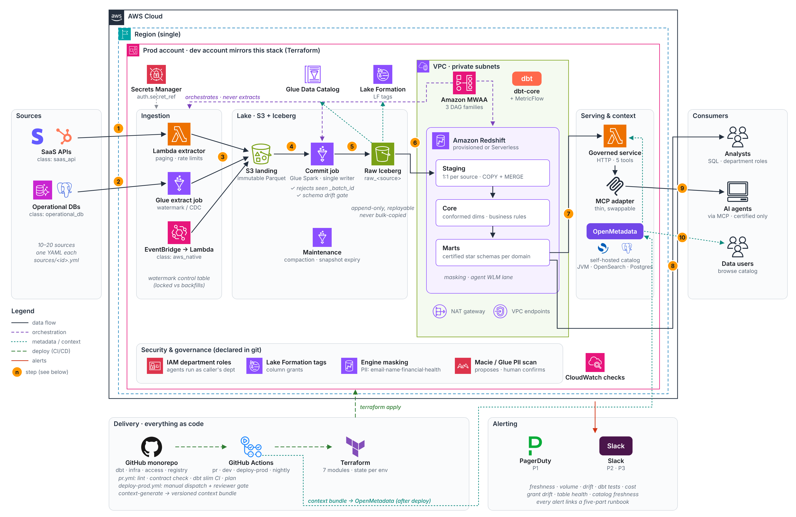

# AWS Data Platform as Code

A reference architecture for a small, fully code-defined data platform on AWS: an S3 + Apache Iceberg lake, Redshift for serving, Airflow (MWAA) + dbt to run it, OpenMetadata as the catalog, and governed access for both analysts and AI agents.

It is sized for a team of 2–4 analysts and one data platform engineer, with 10–20 data sources.

> Status: draft. The full design, decisions and open questions are in [design.md](design.md).

## How it works, end to end

Think of it as a factory that turns messy data from many places into trusted answers.

1. **Collect.** Data comes from SaaS tools (e.g. Stripe, HubSpot), operational databases and AWS services. Each source is described in one small settings file, so adding a source means adding a file, not writing new code.
2. **Keep the original.** Everything is first saved untouched in S3 (the *raw* zone). Nothing there is edited, so any mistake later can be fixed by replaying from the original. A single gatekeeper job is the only writer: it skips data it has already saved (no duplicates) and stops data whose structure changed unexpectedly.
3. **Clean and organise.** Data is copied into Redshift and refined in three steps:
   - **Staging**: a tidy copy of each source.
   - **Core**: sources combined, with shared definitions like "customer" and "order".
   - **Marts**: ready-to-use tables per business area. Only marts that pass a quality checklist (owner, description, tests, personal-data labels) are marked **certified**.
4. **Use it.** Three ways in, all limited to certified data:
   - **Analysts** query the marts with SQL.
   - **AI agents** go through a controlled service with a small set of approved actions, never free-form queries.
   - **Everyone else** browses the OpenMetadata catalog to see what exists, what it means and who owns it.
5. **Keep it safe.** People and agents see data only through their department's permissions. Personal data (email, name, financial, health) is masked automatically.

**Behind the scenes**

- **Scheduling:** Airflow runs collecting, loading and refining in the right order.
- **Everything as code:** infrastructure (Terraform), data models (dbt), permissions and catalog descriptions all live in this repo. Changes are checked automatically, deployed to dev on merge, and go to prod only with a reviewer's approval.
- **Monitoring:** late, missing or broken data raises an alert. Urgent issues go to PagerDuty, smaller ones to Slack, and every alert links to a fix-it runbook.

**In one sentence:** collect data, keep a safe original, refine it into certified tables, and let people and AI use only those, within their permissions, with everything defined in code and monitored.

## Repository

| Path | What it is |
|---|---|
| [design.md](design.md) | Full reference architecture, decision log and open items |
| [docs/architecture.png](docs/architecture.png) | End-to-end architecture diagram |
